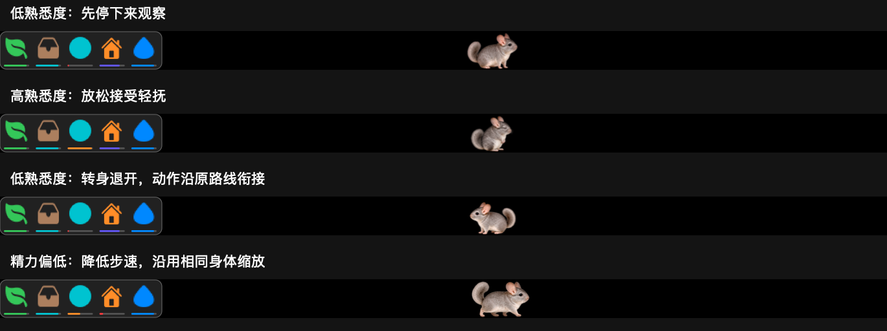

# Touch Bar 小龙猫

**方寸之间，自有生趣。**

一只写实风格的小龙猫，安居于 MacBook Pro 的 Touch Bar。它会缓步探看、抱草细嚼，在细沙间翻滚，也会蜷入小窝安睡。忙碌时偶然低头，便能与这位小小伙伴相遇。

为它放一束牧草，添一瓶清水，或轻轻抚摸，等它自在回应。随着日常照料与相处，熟悉度逐渐变化，靠近、观察与退让也各有分寸。

当前版本 **1.13.2**，提供 Intel 与 Apple 芯片通用安装包。

## 下载与安置

前往 [版本发布页](https://github.com/linxitong98-rgb/TouchBarChinchilla/releases)，下载 `TouchBarChinchilla-1.13.2-universal.dmg`。打开后，将 App 拖入“应用程序”即可。更新时，请先退出旧版，再启动新版。

最低编译目标为 macOS 11。配备 Touch Bar 的 MacBook Pro 可使用触控栏场景；其他 Mac 可在窗口中预览与互动。旧系统的实际兼容性仍需相应设备验证。

## 照料与相伴

- **布置小小居所**：从左侧物品框点选或拖出牧草、沙盘、小球、睡窝与悬挂喂水器。它们可以同时安放，除牧草外各保留一件。
- **随它自在生活**：龙猫会依自身状态进食、饮水、沙浴、玩球与休息；疲倦时放慢节奏，熟悉后也更愿意回应邀请。
- **轻触一声问候**：未选物品时，轻点龙猫即可抚摸；轻点空白处则是邀请它走近，是否回应仍取决于熟悉度与当下状态。
- **照看饮水与环境**：喂水器放出后，水滴图标变为“水滴＋”；点选后轻点喂水器，或拖至同处，即可补满。第六格清洁铲可点选或拖动，整理地面的便粒。
- **随心调整布置**：场景中的物品可自由拖动，拖回物品框即可收纳。图标下的进度条呈现照料状态，物品框贴左，为龙猫留出更多活动空间。
- **留住相处日常**：状态自动保存在本机，并支持备份、恢复与布置撤销；关闭 App 期间不消耗状态。

## 1.13.2 · 回应更细腻，衔接更从容

本版细化了警示喷流的水光、水滴与落点表现，让细小的动态在 Touch Bar 上也清晰可见。防御反应会随左右触碰调整朝向；轻点身体中央时，则沿原有朝向回应。

转身、起势与回应依次衔接，持续触碰不会令同一段反应突然翻面或重新开始。喷流与抛物轨迹贴合身体位置，靠近场景边缘时也保留对应方向；原有体型与动作素材保持稳定。

## 回应也有分寸

持续、快速的打扰会累积戒备。满足触发与冷却条件时，龙猫会按当时的熟悉度作出回应：

| 熟悉度 | 可能的回应 |
| --- | --- |
| 70%及以上 | 观察或退让，不触发特殊防御 |
| 50%～不足70% | 警示喷流 |
| 30%～不足50% | 警示喷流或抛掷便粒 |
| 低于30% | 上述反应，或短暂仰卧静止 |

普通单次轻触不会直接触发特殊防御。每次防御只选择一种反应，并保留10秒冷却；结束后会自行恢复。日常活动中留下的便粒可用清洁铲整理，数量与清理记录会保存。

警示喷流参考龙猫的防御习性；抛掷便粒与短暂仰卧静止（装死）属于游戏化演绎，并非对真实动物典型行为的陈述。熟悉度的阈值、变化幅度与时间均为游戏设定，详细规则见版本附件 `User-Guide.md`。

## 使用说明

App 默认留在菜单栏，预览窗口可以隐藏。Touch Bar 常驻依赖 macOS 未公开接口，属于实验功能，不适用于 Mac App Store；系统升级或其他 Touch Bar 工具可能影响显示。

当前安装包采用本地临时签名，尚无 Apple Developer ID 签名或 Apple 公证。写实素材由图像生成制作，并非实拍或动作捕捉。实体 Touch Bar 的触摸手感、持续帧率及长期跨应用显示，仍需对应设备验证。

完整操作说明见版本附件 `User-Guide.md`，安装包校验值见 `SHA256.txt`。GitHub 自动生成的 Source code 是仓库文件，安装请选择 DMG。
